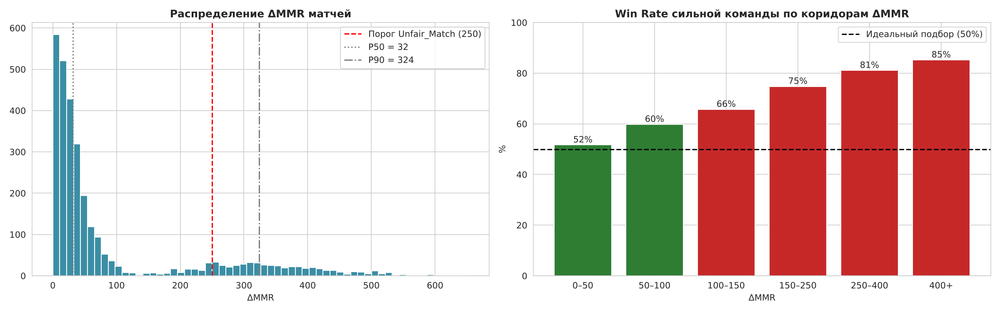
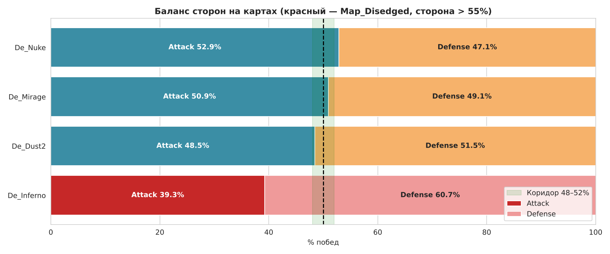
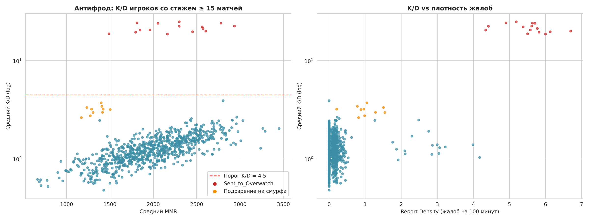
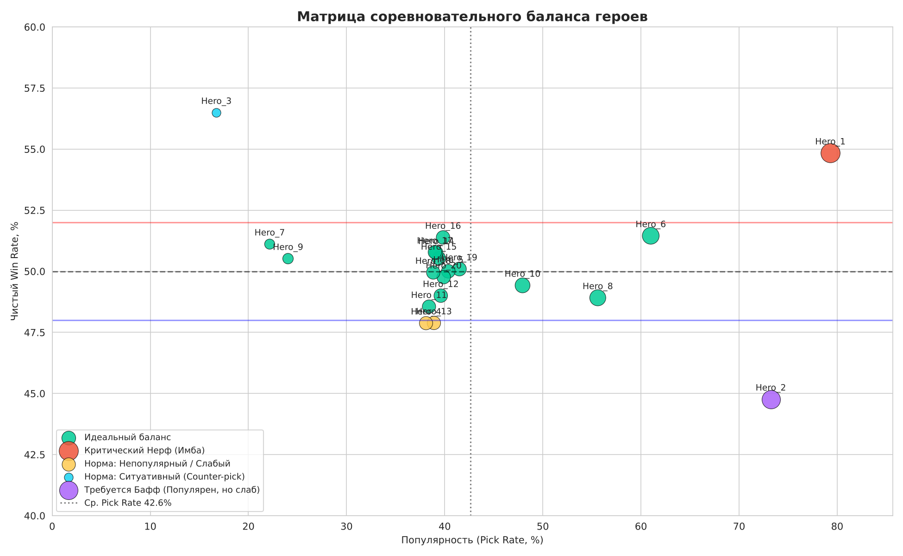

# Game Analytics Lab 4: Мультиплеерная аналитика и баланс героев

Лабораторная работа №4 «Аналитика как конкурентное преимущество» по дисциплине «Игровая аналитика и подходы на основе анализа данных в разработке».

## Цель
1. **Multiplayer Balance & Matchmaking Insights** — серверная логика контроля качества матчмейкинга, баланса карт и антифрода.
2. **Матрица соревновательного баланса персонажей** — интерактивный экран Pick Rate vs Win Rate для решений о баффах и нерфах.

## Структура проекта
- `src/generate_data.py` — генератор синтетических логов 5v5 со скрытыми аномалиями
- `data/` — `matches.csv`, `player_stats.csv`, `reports.csv`, `ground_truth.csv` (скрытая разметка для валидации)
- `notebooks/04_multiplayer_analytics.ipynb` — модули А/Б/В и матрица баланса героев
- `notebooks/dashboard.ipynb` — дашборд Voila с вкладками «Матчмейкинг», «Баланс карт», «Безопасность», «Баланс героев»
- `reports/` — аналитическая записка `lab4_report.md`, графики и витрины для дашборда

## Результаты
- **Матчмейкинг:** медианная ΔMMR 32, но 16,4 % матчей Unfair (ΔMMR > 250) — в них сильная команда выигрывает 81–85 %; чем дольше поиск, тем выше качество подбора.
- **Карты:** De_Inferno — Map_Disedged (Defense 60,7 %, p < 0,001); остальные карты в пределах нормы.
- **Антифрод:** 15 игроков Sent_to_Overwatch (K/D > 4,5) — все 15 читеров найдены без ложных срабатываний; дополнительно 10 смурфов и 16 токсичных игроков.
- **Баланс героев:** Hero_1 — имба (Pick 79 %, Win Rate 54,8 %), Hero_2 — популярен, но слаб (44,8 %), Hero_3 — ситуативный counter-pick.

## Графики
| | |
|---|---|
|  |  |
|  |  |

## Установка
```bash
python -m venv venv
source venv/bin/activate  # или venv\Scripts\activate на Windows
pip install -r requirements.txt
```

## Запуск
```bash
python src/generate_data.py                                # пересоздать данные (seed 2026)
jupyter lab notebooks/04_multiplayer_analytics.ipynb       # анализ: Run → Run All Cells
voila notebooks/dashboard.ipynb --port=8866                # дашборд: http://localhost:8866
```

## Автор
Повтарев Даниил Сергеевич, группа VДММ-101пип
